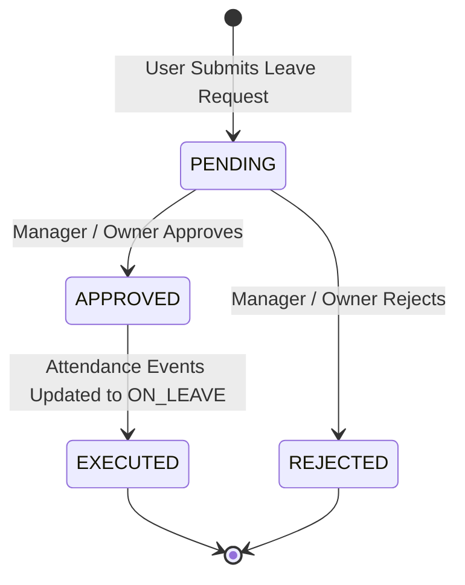
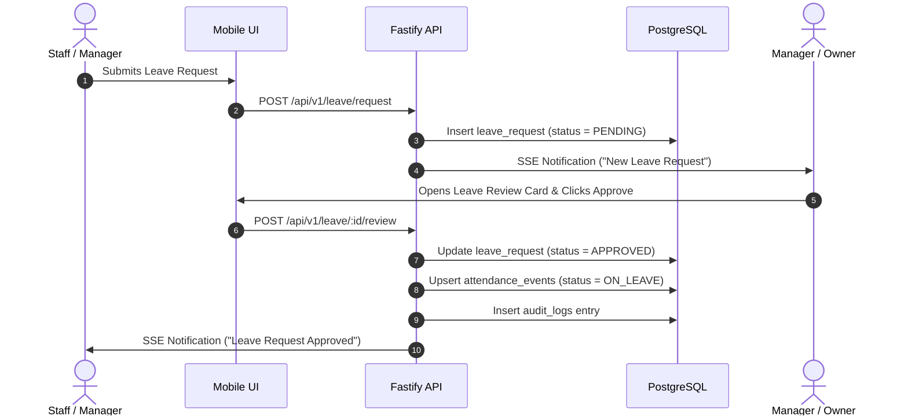

# V1 Approval Architecture: Focused Leave Request Workflow (`docs/APPROVAL_WORKFLOWS.md`)

## 1. V1 Approval Governance Strategy

For **Version 1 (V1 MVP)**, **Leave Request Approval** is designated as the **single official request-and-approval ticket workflow** in the system. 

By centering V1 user interactions around Leave Requests, the system provides a clean, zero-friction operational model while handling all other operational and administrative tasks as direct role-authorized management actions.

```
+-----------------------------------------------------------------------------------+
|                        V1 CORE APPROVAL TICKET WORKFLOW                           |
+-----------------------------------------------------------------------------------+
|                                                                                   |
|                   [ Staff / Manager ] -- Submits Leave Request -->                |
|                                                                                   |
|                   [ Manager / Owner ] -- Reviews & Approves/Rejects -->           |
|                                                                                   |
|                   [ System Engine ]  -- Updates Attendance & Wallet Pay           |
|                                                                                   |
+-----------------------------------------------------------------------------------+
```

---

## 2. Shift-Scoped Leave Request Approval Workflow

### 2.1 Overview & Business Objectives
- **Objective**: Allows employees (Staff & Managers) to submit time-off requests for specific assigned shifts or entire workdays (`CASUAL`, `SICK`, `UNPAID`) for administrative review and automatic attendance/wallet integration.
- **Shift Scoping**: Leave is bound to specific shift assignments or templates (e.g. "Morning Shift 09:00 - 17:00") or applies to all assigned shifts on the selected dates.
- **Roles**:
  - Requester: `STAFF` (reviewed by `MANAGER`) or `MANAGER` (reviewed by `OWNER`).
  - Approver: `MANAGER` or `OWNER`.

### 2.2 Lifecycle State Machine



---

### 2.3 Data Model & REST API Specifications

#### **1. Submit Leave Request**
- **HTTP Method**: `POST /api/v1/leave/request`
- **Headers**: `Authorization: Bearer <JWT_ACCESS_TOKEN>`
- **Request Payload**:
  ```json
  {
    "leaveType": "CASUAL",
    "startDate": "2025-02-10",
    "endDate": "2025-02-12",
    "reason": "Family function"
  }
  ```
- **Response (`201 Created`)**:
  ```json
  {
    "id": "8f3b2a1c-9d4e-4f5a-b6c7-1d8e9f0a2b3c",
    "staffProfileId": "3fa85f64-5717-4562-b3fc-2c963f66afa6",
    "leaveType": "CASUAL",
    "startDate": "2025-02-10",
    "endDate": "2025-02-12",
    "reason": "Family function",
    "status": "PENDING",
    "createdAt": "2025-02-01T10:30:00Z"
  }
  ```

#### **2. Review & Approve/Reject Leave Request**
- **HTTP Method**: `POST /api/v1/leave/:id/review`
- **Headers**: `Authorization: Bearer <JWT_ACCESS_TOKEN>`
- **Request Payload**:
  ```json
  {
    "status": "APPROVED",
    "comments": "Approved. Have a good time."
  }
  ```
- **Response (`200 OK`)**:
  ```json
  {
    "id": "8f3b2a1c-9d4e-4f5a-b6c7-1d8e9f0a2b3c",
    "status": "APPROVED",
    "reviewedBy": "7e2a1b0c-8d3e-4f5a-a6b7-0c9d8e7f6a5b",
    "reviewedAt": "2025-02-01T11:00:00Z",
    "comments": "Approved. Have a good time."
  }
  ```

---

### 2.4 Execution & System Mutations
Upon approval (`status = APPROVED`):
1. **Attendance State**: For each calendar date in `[startDate, endDate]`, the engine inserts or updates `attendance_events` with `status = ON_LEAVE`.
2. **Salary Engine Integration**: During monthly payroll calculation, approved `ON_LEAVE` days are evaluated against `unworked_payment_rules`:
   - Paid Leave (`CASUAL` / `SICK`): Accrues full shift leave pay as defined in `unworked_payment_rules`.
   - Unpaid Leave: Accrues $0.00 pay for the leave duration.
3. **Audit Trail**: Writes an entry to `audit_logs` with `action = LEAVE_APPROVED` and `actor_id = reviewer_id`.
4. **Real-Time Delivery**: Emits an SSE event to push live status updates to the applicant's mobile device.

---

## 3. How Non-Approval Operations Work in V1 (Direct Role Actions)

To maintain maximum simplicity in V1, all other management tasks bypass approval ticket queues and operate as direct, role-authorized actions:

| Domain Area | V1 Operation Mode | Handling Mechanism |
| :--- | :--- | :--- |
| **Attendance Corrections** | Direct Supervisor Resolution | Manager reviews missed clock-in/out exceptions on the dashboard and clicks **"Mark Present"** or **"Mark Absent"** directly. |
| **Overtime (OT) Logs** | Direct Supervisor Logging | Manager inputs or verifies extra worked minutes directly during daily roster checks or payroll preparation. |
| **Monthly Payroll & Disbursal** | Direct Disbursement Console | Manager/Owner opens monthly payroll console, reviews calculated totals, and clicks **"Pay Staff"** via `PayStaffModal`. |
| **Premises & Geofence Setup** | Direct Admin Configuration | Owner/Manager configures premises coordinates and geofence radius directly in settings. |
| **Shift Scheduling & Rates** | Direct Roster Assignment | Manager assigns shifts from 7-day card modals and configures shift payment rates directly. |
| **Face Biometric Enrollment** | Direct In-Person Enrollment | Manager/Owner supervises 5-pose multi-angle face enrollment directly on the device. |

---

## 4. V1 Approval Summary Table

| Approval Topic | Requester | Approver | Database Entity | REST Endpoint |
| :--- | :---: | :---: | :--- | :--- |
| **Leave Request** | Staff / Manager | Manager / Owner | `leave_requests` | `POST /api/v1/leave/request` <br> `POST /api/v1/leave/:id/review` |

---

## 5. Audit Logging & Notification Sequence


