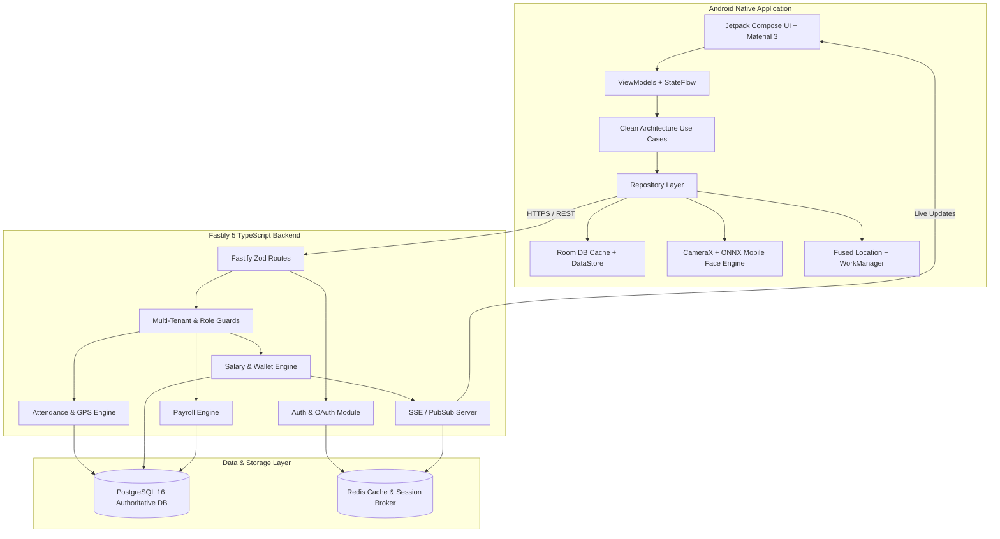

# System Architecture (`docs/ARCHITECTURE.md`)

## 1. High-Level Architecture Overview

The system consists of an Android native mobile application (`com.als.presence`), a Node.js/TypeScript Fastify REST API, a PostgreSQL relational database, and a Redis caching and pub/sub broker.

---

## 2. Android Client Architecture

The Android app follows **Clean Architecture** with **MVVM** and **Unidirectional Data Flow (UDF)**.

### Architectural Layers
1. **Presentation Layer**:
   - Jetpack Compose Composables.
   - `ViewModel` holding an immutable `UiState` in `StateFlow`.
   - Collects state lifecycle-awarely using `collectAsStateWithLifecycle()`.
2. **Domain Layer**:
   - Use Cases (`ClockInUseCase`, `GetWalletSummaryUseCase`, `ProcessPayrollUseCase`).
   - Domain Models (decoupled from network DTOs and Room entities).
   - Repository Interfaces.
3. **Data Layer**:
   - Repository Implementations.
   - Network Data Sources (Retrofit 2 with KotlinX Serialization).
   - Local Data Sources (Room DAO for offline sync queues & DataStore for auth tokens/preferences).
   - Biometric & Location Hardware Services (CameraX + ONNX Runtime Mobile, Fused Location Provider).

---

## 3. Backend Architecture

The Fastify server is structured in modular, domain-centric modules located in `/server/src/modules/`.

### Module Components
Each module (e.g. `/attendance`) contains:
- `routes.ts`: Fastify route definitions with Zod schema validation.
- `schemas.ts`: Request, response, and query parameter Zod contracts.
- `service.ts`: Core business logic and rules enforcement.
- `repository.ts`: Drizzle ORM query execution against PostgreSQL.
- `types.ts`: TypeScript interfaces and domain types.

### Middleware & Plugins
- `fastify-type-provider-zod`: Automated Zod compile-time and runtime validation.
- `@fastify/cors` & `@fastify/helmet`: Security headers and CORS handling.
- Auth Plugin: Verifies JWT bearer tokens and active session status in Redis.
- Tenant Guard Plugin: Verifies user membership in target `organization_id` and checks role permissions.

---

## 4. Real-Time & Caching Strategy

1. **Authoritative Source**: PostgreSQL is the single source of truth for all persistent entities, attendance logs, and financial ledgers.
2. **Redis Roles**:
   - **OAuth State & Rate Limiting**: Stores short-lived OAuth authorization states and enforces IP/user rate limits.
   - **Session Tracking**: Tracks active JWT jti / session tokens to enable instant token revocation.
   - **Pub/Sub**: Coordinates financial and attendance events across API instances to broadcast via Server-Sent Events (SSE).
3. **Real-Time Client Updates**:
   - When a wallet transaction or attendance check is committed to PostgreSQL, an event is published to Redis Pub/Sub.
   - The SSE plugin streams the event to the user's Android app, triggering immediate UI state updates.
