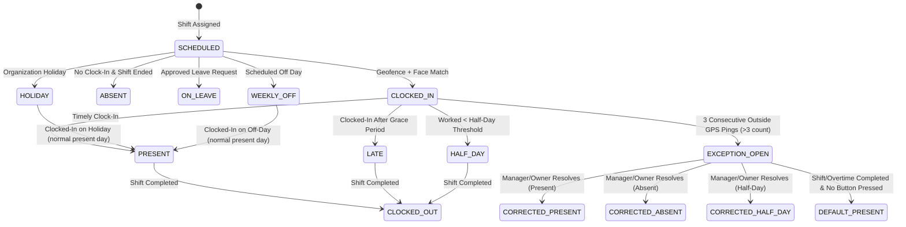

# Attendance State Machine & Policy Engine (`docs/ATTENDANCE_RULES.md`)

## 1. Attendance State Transition Diagram

---

## 2. Clock-In Validation Policy
> [!NOTE]
> Attendance tracking and clock-in apply exclusively to employees (**Staff** and **Managers**). The **Owner** is the head of the organization, is NOT an employee, has NO attendance tracking, and does NOT clock in.

1. **Distance Check**: Distance between device GPS coordinates and premise coordinates must be $\le 50\text{ metres}$.
2. **Accuracy Threshold**: GPS reading `accuracyMeters` must be $\le 30\text{ metres}$. Stale location readings ($>2\text{ minutes}$ old) or flagged mock locations are rejected.
3. **Face Verification Check**: Cosine similarity score between clock-in embedding and enrolled template must exceed the configured threshold ($\ge 0.75$).
4. **Shift Match**: Clock-in is validated against assigned shift schedules.

---

## 3. Late Arrival & Half-Day Rules
1. **Grace Period**: Default 15 minutes after shift `start_time`. Clock-in within grace period is marked `PRESENT`.
2. **Late Threshold**: Clock-in past grace period is marked `LATE`.
3. **Half-Day Threshold**: Total worked duration $< 50\%$ of scheduled shift minutes is marked `HALF_DAY`.
4. **Early Departure**: Clock-out prior to scheduled shift end time minus grace period is flagged as Early Departure.

---

## 4. Manual Resolution & Exception Workflows (3 Consecutive Outside Pings)
1. **Trigger Condition**: When periodic active-shift location monitoring records **3 consecutive outside pings** (`consecutiveFailures >= 3` / outside count $> 3$), an attendance monitoring exception is raised.
2. **Action Buttons Persistence**: Resolution action buttons (Absent, Half-Day, Leave, Resume) appear on the Owner and Manager dashboard and remain visible and active **until the shift or overtime is completely finished/completed**.
3. **Manual Options**: Owner or Manager can manually mark attendance as `ABSENT`, `HALF_DAY`, `LEAVE`, or resume tracking (`RESUME`).
4. **Default Present Rule (No Action)**: If the owner or manager **does not press any button** before the shift or overtime session completes, the system automatically **defaults the attendance status to Present** (`PRESENT`).
5. **Audit Logging**: Manual overrides and final resolutions are tracked in `audit_logs` and `attendance_corrections`.
