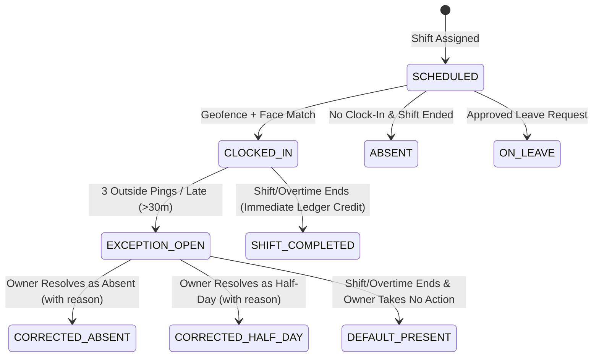

# Attendance State Machine & Policy Engine (`docs/ATTENDANCE_RULES.md`)

## 1. Attendance State Transition Diagram

---

## 2. Clock-In Validation Policy & Single Clock-In Model
> [!NOTE]
> Attendance tracking and clock-in apply exclusively to **Employees**. The **Owner** is the head of the organization, is NOT an employee, has NO attendance tracking, and does NOT clock in.

1. **Single Clock-In Model (No Clock-Out Route)**: Employees clock in once per shift/overtime session. There is **no clock-out route or clock-out action**. The active shift session runs from clock-in until the scheduled shift end time.
2. **Distance Check**: Distance between device GPS coordinates and premise coordinates must be $\le 50\text{ metres}$.
3. **Accuracy Threshold**: GPS reading `accuracyMeters` must be $\le 30\text{ metres}$. Stale location readings ($>2\text{ minutes}$ old) or flagged mock locations are rejected.
4. **Face Verification Check**: Cosine similarity score between clock-in embedding and enrolled template must exceed the configured threshold ($\ge 0.75$).
5. **Shift Match**: Clock-in is validated against assigned shift schedules. On holidays and weekly off-days, regular shifts are not scheduled; work is performed via scheduled/approved Overtime.

---

## 3. Shift Completion & Immediate Earning Ledger Posting
1. **Automated Shift End Completion**: When the scheduled shift or overtime end time passes, the background engine automatically completes the session.
2. **Immediate Ledger Accrual**:
   - If the Owner manually marked the status as `ABSENT`, `HALF_DAY`, or `LEAVE` with a reason, earnings accrue based on that manual choice (`absentPay` ₹0, `halfDayPay`, or `leavePay`).
   - If no Owner override exists, the status defaults to **`PRESENT`** (Default Present Policy) and earnings (`presentPay` or approved overtime `paymentInr`) post immediately to `staff_earning_ledger`.
3. **GPS Ping Termination**: Background location monitoring pings immediately terminate once the shift/overtime end time passes.

---

## 4. Manual Resolution & Exception Workflows (Owner Actions)
1. **Trigger Conditions**: An attendance monitoring exception (`EXCEPTION_OPEN`) is automatically raised under any of these conditions:
   - **3 Consecutive Outside GPS Pings** (`consecutiveFailures >= 3` / outside count $> 3$).
   - **Late Clock-In (> 30 minutes late)**: Clocking in more than 30 minutes past shift start time.
2. **Action Buttons Persistence**: Resolution action buttons (Absent, Half-Day, Leave, Resume) appear on the Owner dashboard and remain visible and active **until the shift or overtime is completely finished/completed**.
3. **Manual Options**: Owner can manually resolve attendance status as `ABSENT` or `HALF_DAY` with mandatory reason/remarks, or resume tracking (`RESUME`).
4. **Default Present Rule (No Action)**: If the owner **does not press any button** before the shift or overtime session completes, the system automatically **defaults the attendance status to Present** (`PRESENT`) and credits full shift pay upon shift end.

---

## 5. Shift & Overtime Pay Rules
1. **Shift Pay Rules**:
   - **Present**: Earns full scheduled shift pay rate (`presentPay`).
   - **Half-Day**: Earns half-day pay rate (`halfDayPay`, default 50% of present pay).
   - **Leave**: Earns approved leave pay rate (`leavePay`).
   - **Absent**: Earns `absentPay` (default ₹0, or configured rate if `absentPay > 0` on shift assignment).
2. **Overtime Pay Rules**:
   - **Creation & Approval**: The **Owner** creates and approves overtime entries for the employee (`paymentInr`).
   - **Execution & Completion**: The **Employee** clocks in for the assigned overtime session. Earnings accrue immediately when overtime end time passes.
   - **Present (Completed)**: Earns 100% of approved overtime pay (`paymentInr`).
   - **Absent / Unworked**: Earns ₹0.
