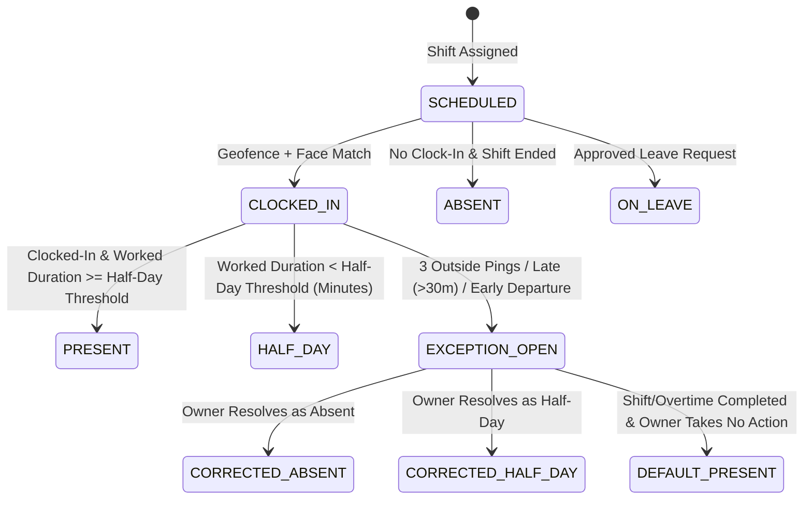

# Attendance State Machine & Policy Engine (`docs/ATTENDANCE_RULES.md`)

## 1. Attendance State Transition Diagram

---

## 2. Clock-In Validation Policy
> [!NOTE]
> Attendance tracking and clock-in apply exclusively to **Employees**. The **Owner** is the head of the organization, is NOT an employee, has NO attendance tracking, and does NOT clock in.

1. **Distance Check**: Distance between device GPS coordinates and premise coordinates must be $\le 50\text{ metres}$.
2. **Accuracy Threshold**: GPS reading `accuracyMeters` must be $\le 30\text{ metres}$. Stale location readings ($>2\text{ minutes}$ old) or flagged mock locations are rejected.
3. **Face Verification Check**: Cosine similarity score between clock-in embedding and enrolled template must exceed the configured threshold ($\ge 0.75$).
4. **Shift Match**: Clock-in is validated against assigned shift schedules. On holidays and weekly off-days, regular shifts are not scheduled; work is performed via scheduled/approved Overtime.

---

## 3. Half-Day Rules
1. **Half-Day Threshold (in Minutes)**: Configured in minutes (`halfDayThresholdMinutes`). Attendance is marked `HALF_DAY` if total worked duration (accounting for late clock-in or early departure) is less than the half-day threshold in minutes (e.g., $< 50\%$ of scheduled shift minutes).

---

## 4. Manual Resolution & Exception Workflows (Triggers & Owner Actions)
1. **Trigger Conditions**: An attendance monitoring exception (`EXCEPTION_OPEN`) is automatically raised under any of these conditions:
   - **3 Consecutive Outside GPS Pings** (`consecutiveFailures >= 3` / outside count $> 3$).
   - **Late Clock-In (> 30 minutes late)**: Clocking in more than 30 minutes past shift start time.
   - **Early Departure**: Clocking out early or missing pings before shift end time automatically increments outside/missed pings, opening an exception.
2. **Action Buttons Persistence**: Resolution action buttons (Absent, Half-Day, Leave, Resume) appear on the Owner dashboard and remain visible and active **until the shift or overtime is completely finished/completed**.
3. **Manual Options**: Owner can manually resolve attendance as `ABSENT` or `HALF_DAY` (for late clock-in, early departure, or location exceptions), or resume tracking (`RESUME`). No manual "Present" button is needed because un-actioned sessions automatically default to Present.
4. **Default Present Rule (No Action)**: If the owner **does not press any button** before the shift or overtime session completes, the system automatically **defaults the attendance status to Present** (`PRESENT`).
5. **Session Completion & Ping Termination**: Once a shift or overtime session ends (or clock-out occurs), attendance is marked **completed**. Background location monitoring pings immediately terminate; no further pings or new exceptions can be triggered after session completion.

---

## 5. Shift & Overtime Pay Rules
1. **Shift Pay Rules**:
   - **Present**: Earns full scheduled shift pay rate (`presentPay`).
   - **Half-Day**: Earns half-day pay rate (`halfDayPay`, default 50% of present pay).
   - **Leave**: Earns approved leave pay rate (`leavePay`).
   - **Absent**: Earns ₹0 (`absentPay`).
2. **Overtime Pay Rules**:
   - **Creation & Approval**: The **Owner** creates and approves overtime entries for the employee (`paymentInr`).
   - **Execution & Completion**: The **Employee** clocks in for the assigned overtime session and clocks out upon completion.
   - **Present (Completed)**: Earns 100% of approved overtime pay (`paymentInr`).
   - **Absent / Unworked**: Earns ₹0.

