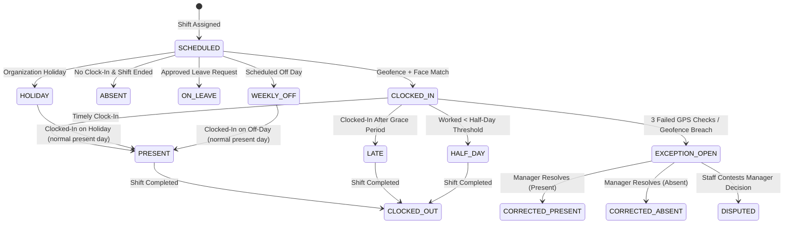

# Attendance State Machine & Policy Engine (`docs/ATTENDANCE_RULES.md`)

## 1. Attendance State Transition Diagram

---

## 2. Clock-In Validation Policy
1. **Distance Check**: Distance between device GPS coordinates and premise coordinates must be $\le 50\text{ metres}$.
2. **Accuracy Threshold**: GPS reading `accuracyMeters` must be $\le 30\text{ metres}$. Stale location readings ($>2\text{ minutes}$ old) or flagged mock locations are rejected.
3. **Face Verification Check**: Cosine similarity score between clock-in embedding and enrolled template must exceed the configured threshold ($\ge 0.75$).
4. **Shift Match**: Clock-in is validated against assigned shift schedules.

---

## 3. Late Arrival & Half-Day Rules
1. **Grace Period**: Default 15 minutes after shift `start_time`. Clock-in within grace period is marked `PRESENT`.
2. **Late Threshold**: Clock-in past grace period is marked `LATE`.
3. **Half-Day Threshold**: Total worked duration $< 50\%$ of scheduled shift minutes is marked `HALF_DAY`.
4. **Early Departure**: Clock-out prior to scheduled shift end time minus grace period is flagged as Early Departure.

---

## 4. Manual Resolution & Exception Workflows
1. **Immutable History**: Original clock-in event rows are never deleted or modified.
2. **Correction Audit**: Manual overrides create an `attendance_corrections` entry referencing the original `attendance_exceptions` record, storing `actor_id`, timestamp, and reason text.
3. **Approval Escalation**: Manager corrections involving financial rate changes or sensitive absences require Owner review if configured by policy.
