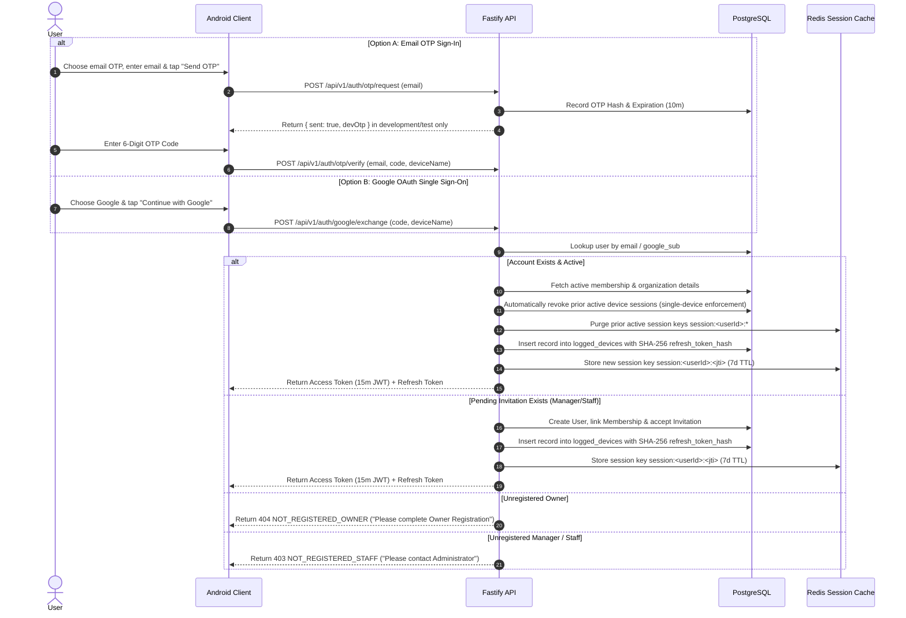

# Authentication Architecture & Session Management (`docs/AUTHENTICATION.md`)

## 1. Authentication Providers & Identity Verification Flow

Authentication in **Presence** supports two identity verification mechanisms for all roles (`OWNER`, `MANAGER`, `STAFF`):
1. **Email 6-Digit OTP**: Requested via `POST /api/v1/auth/otp/request` and verified via `POST /api/v1/auth/otp/verify`.
2. **Google Sign-In**: Android requests only the user's basic identity/profile and sends a server authorization code to `POST /api/v1/auth/google/exchange`.

Google sign-in is the primary Android login action, with email OTP available as an alternative. The Android UI presents a method-specific note alongside the selected authentication method:

- **Google**: explains that Google is used for identity and basic profile verification only; Gmail, Drive, contacts, and other Google data are not accessed.
- **Email OTP**: explains that the one-time email code verifies the sign-in/owner account and does not use or access Google account data. Google-specific privacy copy is not shown while email OTP is selected.

These notes describe the data used by each method; they do not change the server-side authentication contracts.

### 1.1 Email OTP & Google OAuth Authentication Sequence

---

## 2. Owner Registration

Before an independent Owner can create a new organization, their email address MUST be verified via either Email OTP or Google OAuth:

Owner registration follows a three-step Android flow:

1. **Verify identity** with an email OTP or Google Sign-In.
2. **Organization details**: enter the organization name, timezone, and currency.
3. **Premises and review**: enter the first premises name and geofence radius, review the details, and submit.

The identity step presents privacy information for the selected method only. Email OTP explains that the code verifies the owner email and does not access Google data; Google explains that only identity/basic profile details are used.

For email OTP, `POST /api/v1/auth/otp/request` returns a `devOtp` only when `NODE_ENV` is `development` or `test`. The six-digit code is hashed before it is stored in PostgreSQL. The code is verified when the final registration request is submitted.

For Google, Android requests an ID token using the configured Google web client ID. The app sends the token and organization details to `POST /api/v1/auth/google/owner-registration`; the server verifies the token audience, verified email, and Google subject before provisioning the owner.

The Google registration endpoint creates the owner, Google identity, organization, membership, and initial premises in one PostgreSQL transaction. It rejects an email that already has an account; existing users should sign in instead.

---

## 3. Logged Devices & Refresh Token Hash Security

### 3.1 `logged_devices` Table
To maintain strict auditability, device tracking, and refresh token security, every session is persisted in PostgreSQL in the `logged_devices` table:
- `user_id`: UUID referencing `users.id`.
- `session_jti`: Unique session identifier string matching the JWT payload claim `jti`.
- `refresh_token_hash`: SHA-256 cryptographic hash of the active refresh token. Plaintext refresh tokens are never persisted in the database.
- `device_name`, `device_type`, `os_name`: Optional device parameters submitted during authentication or token refresh (e.g. "Google Pixel 8", "MOBILE", "Android 14").
- `ip_address` & `user_agent`: Extracted from HTTP request headers.
- `is_active`: Boolean flag indicating whether the device session is currently valid.
- `last_active_at`, `created_at`, `revoked_at`: Timestamps tracking session lifecycle.

### 3.2 Single-Device Concurrency Enforcement (All Roles)
To prevent account sharing and enforce device security across all organization members (`OWNER`, `MANAGER`, `STAFF`):
- **Single Active Session Constraint**: A user is allowed exactly **1 active device session** at any time.
- **Automatic Previous Session Revocation**: When a user authenticates on a new/latest device, all prior active device sessions for that user are automatically revoked (`is_active = false`, `revokedAt = NOW()`) in PostgreSQL, and corresponding session keys in Redis are deleted.
- **Revoked Session Behavior**: Any subsequent API request from a previously logged-in device will fail with `401 SESSION_EXPIRED`.

---

## 4. Token Specification & Security Controls

### 4.1 Access Token (JWT)
- **Lifetime**: 15 minutes.
- **Claims**:
  - `userId`: Internal User UUID.
  - `googleSub`: Google Identity ID or Email Sub.
  - `organizationId`: Active Organization UUID.
  - `role`: `OWNER` | `MANAGER` | `STAFF`.
  - `jti`: Unique Session JWT ID stored in Redis.
  - `iat` & `exp`: Issuance and expiration timestamps.

### 4.2 Refresh Token
- **Lifetime**: 7 days (`refresh:<userId>:<jti>`).
- **Storage**: Encrypted DataStore on Android / Secure HTTP-only cookie on Web.
- **Hash Verification & Rotation**: Upon token refresh (`POST /api/v1/auth/refresh`), the server verifies that `logged_devices` has an active record matching `jti` and that the SHA-256 hash of the presented refresh token matches `refresh_token_hash`. Every refresh token exchange generates a new `jti` and rotated refresh token, updating the active `logged_devices` record.

### 4.3 Session Revocation Endpoints
- **Logout Endpoint**: `POST /api/v1/auth/logout` revokes the active `session:<userId>:<jti>` key from Redis and marks the active `logged_devices` record inactive.
- **Global Logout**: `POST /api/v1/auth/logout-all` purges all active session keys matching `session:<userId>:*` from Redis and revokes all active device records in `logged_devices`.
- **List Devices**: `GET /api/v1/auth/devices` returns a list of all logged device sessions for the authenticated user.
- **Revoke Specific Device**: `DELETE /api/v1/auth/devices/:deviceId` revokes a targeted device session by its ID.

Redis connects lazily on the first Redis-dependent operation, not during server startup. If Redis is unavailable, the server logs one warning for the outage; session operations use their documented database fallback behavior.
