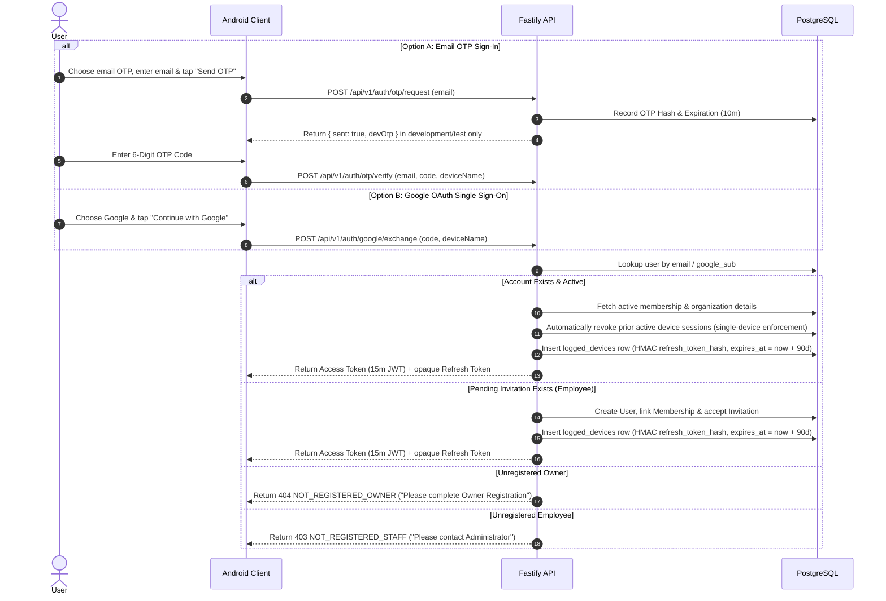

# Authentication Architecture & Session Management (`docs/AUTHENTICATION.md`)

## 1. Authentication Providers & Identity Verification Flow

Authentication in **Presence** supports two identity verification mechanisms for all roles (`OWNER`, `EMPLOYEE`):
1. **Email 6-Digit OTP**: Requested via `POST /api/v1/auth/otp/request` and verified via `POST /api/v1/auth/otp/verify`.
2. **Google Sign-In**: Android requests only the user's basic identity/profile and sends a server authorization code to `POST /api/v1/auth/google/exchange`.

Google sign-in is the primary Android login action, with email OTP available as an alternative. The Android UI presents a method-specific note alongside the selected authentication method:

- **Google**: explains that Google is used for identity and basic profile verification only; Gmail, Drive, contacts, and other Google data are not accessed.
- **Email OTP**: explains that the one-time email code verifies the sign-in/owner account and does not use or access Google account data. Google-specific privacy copy is not shown while email OTP is selected.

These notes describe the data used by each method; they do not change the server-side authentication contracts.

### 1.1 Email OTP & Google OAuth Authentication Sequence

---

## 2. Owner Registration

Before an independent Owner can create a new organization, their email address MUST be verified via either Email OTP or Google OAuth:

Owner registration follows a three-step Android flow:

1. **Verify identity** with an email OTP or Google Sign-In.
2. **Organization details**: enter the organization name, timezone, and currency.
3. **Premises and review**: enter the first premises name and geofence radius, review the details, and submit.

The identity step presents privacy information for the selected method only. Email OTP explains that the code verifies the owner email and does not access Google data; Google explains that only identity/basic profile details are used.

For email OTP, `POST /api/v1/auth/otp/request` returns a `devOtp` only when `NODE_ENV` is `development` or `test`. The six-digit code is hashed before it is stored in PostgreSQL. The code is verified when the final registration request is submitted.

For Google, Android requests an ID token using the configured Google web client ID. The app sends the token and organization details to `POST /api/v1/auth/google/owner-registration`; the server verifies the token audience, verified email, and Google subject before provisioning the owner.

The Google registration endpoint creates the owner, Google identity, organization, membership, and initial premises in one PostgreSQL transaction. It rejects an email that already has an account; existing users should sign in instead.

---

## 3. Logged Devices & Refresh Token Hash Security

### 3.1 `logged_devices` Table
To maintain strict auditability, device tracking, and refresh token security, every session is persisted in PostgreSQL in the `logged_devices` table:
- `user_id`: UUID referencing `users.id`.
- `session_jti`: Unique session identifier matching the JWT payload claim `jti`. It is stable for the lifetime of the session and does **not** change on refresh, so already-issued access tokens and open WebSockets remain valid until they expire.
- `refresh_token_hash`: HMAC-SHA256 of the active refresh token, keyed with `REFRESH_TOKEN_SECRET` (a server-side pepper). Plaintext refresh tokens are never persisted.
- `previous_refresh_token_hash` & `previous_rotated_at`: The token replaced by the most recent rotation and when it was replaced. Used for the retry grace window and reuse detection.
- `expires_at`: Sliding 3-month (90-day) refresh-token expiry, extended on every successful rotation.
- `device_name`, `device_type`, `os_name`: Optional device parameters submitted during authentication or token refresh (e.g. "Google Pixel 8", "MOBILE", "Android 14").
- `ip_address` & `user_agent`: Extracted from HTTP request headers.
- `is_active`: Boolean flag indicating whether the device session is currently valid.
- `last_active_at`, `created_at`, `revoked_at`, `revoked_reason`: Timestamps and reason (`LOGOUT`, `LOGOUT_ALL`, `REVOKED_BY_USER`, `REPLACED_BY_NEW_LOGIN`, `EXPIRED`, `REFRESH_TOKEN_REUSE`, `ACCOUNT_DEACTIVATED`, `NO_MEMBERSHIP`) tracking the session lifecycle.

### 3.2 Single-Device Concurrency Enforcement (All Roles)
To prevent account sharing and enforce device security across all organization members (`OWNER`, `EMPLOYEE`):
- **Single Active Session Constraint**: A user is allowed exactly **1 active device session** at any time.
- **Automatic Previous Session Revocation**: When a user authenticates on a new/latest device, all prior active device sessions for that user are automatically revoked (`is_active = false`, `revoked_at = NOW()`, `revoked_reason = 'REPLACED_BY_NEW_LOGIN'`) in PostgreSQL.
- **Revoked Session Behavior**: Any subsequent API request from a previously logged-in device fails with `401 DEVICE_REVOKED`. A token whose `logged_devices` row no longer exists fails with `401 SESSION_NOT_FOUND`, and an expired session fails with `401 SESSION_EXPIRED`.
- **WebSocket Enforcement**: `/api/v1/events/ws` validates the session at handshake time and revalidates it against PostgreSQL on every 30-second heartbeat, so revocation closes already-open sockets.

---

## 4. Token Specification & Security Controls

### 4.1 Access Token (JWT)
- **Lifetime**: 15 minutes.
- **Claims**:
  - `userId`: Internal User UUID.
  - `googleSub`: Google Identity ID or Email Sub.
  - `organizationId`: Active Organization UUID.
  - `role`: `OWNER` | `EMPLOYEE`.
  - `jti`: Session identifier matching `logged_devices.session_jti`. It is stable across refresh rotations.
  - `iat` & `exp`: Issuance and expiration timestamps.
- **Never trusted alone**: every authenticated request re-reads `logged_devices`, `users`, and the authoritative organization role from PostgreSQL.

### 4.2 Refresh Token
- **Format**: opaque, high-entropy `rt_<48 random bytes as base64url>` (384 bits). The token is **not** a JWT and is **not** derivable from the access token payload.
- **Lifetime**: 3-month (90-day) sliding expiry (`logged_devices.expires_at`), extended on every successful rotation. Because only one device session per user is allowed, this is the effective sign-in lifetime for that device; a new login on another device revokes it.
- **Storage**: Android Keystore-backed `EncryptedSharedPreferences`. Only the HMAC-SHA256 hash is stored server-side.
- **Rotation**: `POST /api/v1/auth/refresh` locks the session row with `SELECT ... FOR UPDATE`, validates `is_active` and `expires_at`, then replaces `refresh_token_hash` with a freshly generated token in the same transaction. The old hash is retained as `previous_refresh_token_hash`.
- **Reuse Detection**: presenting the previous token more than 30 seconds after rotation is treated as token theft. The session is revoked (`revoked_reason = 'REFRESH_TOKEN_REUSE'`) and the API returns `401 REFRESH_TOKEN_REUSE`. The 30-second window only exists so a client can retry when a rotation response is lost in transit.
- **Concurrency**: `SELECT ... FOR UPDATE` serializes concurrent refreshes, and the Android `TokenAuthenticator` uses double-checked locking to avoid issuing two rotations for one expired access token.
- **Legacy Tokens**: old `refresh:<userId>:<jti>` tokens are rejected with `401 INVALID_REFRESH_TOKEN`; affected clients must sign in once after deploying this change.

### 4.3 Client Refresh Failure Handling
- **Definitive Rejection**: a `400`/`401`/`403` from `POST /api/v1/auth/refresh` means the session can never recover. The Android `TokenAuthenticator` clears the stored tokens and emits a session-revoked signal.
- **UI Fallback**: `AuthRepositoryImpl` observes that signal and clears its in-memory user, so `MainActivity` switches from the dashboard to the login screen even when the failure happens in a background request.
- **Transient Errors**: timeouts, offline errors, and `5xx` responses keep the refresh token intact. The next request retries the refresh instead of forcing a re-login.
- **No Refresh Loop**: the refresh call uses a dedicated OkHttp client without the `Authenticator`, so a failing refresh cannot recursively trigger another refresh.

### 4.4 Session Revocation Endpoints
- **Logout Endpoint**: `POST /api/v1/auth/logout` marks the active `logged_devices` record inactive (`revoked_reason = 'LOGOUT'`).
- **Global Logout**: `POST /api/v1/auth/logout-all` revokes all active device records in `logged_devices` (`revoked_reason = 'LOGOUT_ALL'`).
- **List Devices**: `GET /api/v1/auth/devices` returns a list of all logged device sessions for the authenticated user.
- **Revoke Specific Device**: `DELETE /api/v1/auth/devices/:deviceId` revokes a targeted device session by its ID (`revoked_reason = 'REVOKED_BY_USER'`).

PostgreSQL is the only session store; there is no Redis dependency for authentication or session revocation.
