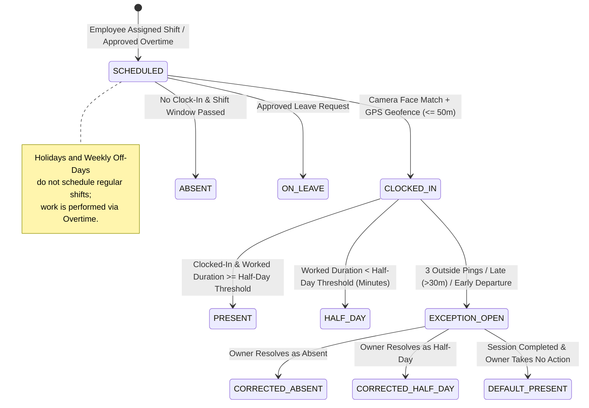

# Employee Clock-In Tab Flow & Business Logic Specification (`docs/CLOCK_IN_TAB_FLOW_AND_LOGIC.md`)

## 1. Executive Summary & Role Scope

The **Employee Clock-In System** provides automated, tamper-proof attendance verification combining **on-device ONNX face recognition**, **geofenced GPS location validation ($\le 50\text{m}$)**, **real-time shift pay rule visualization**, and **periodic background GPS monitoring**.

> [!IMPORTANT]
> **Role & Access Scope**: Clock-in and attendance tracking apply exclusively to **Employees** (`role = 'EMPLOYEE'`). The **Owner** (`organizations.owner_user_id`) is the head of the organization, is NOT an employee, has NO attendance tracking, and does NOT clock in.

---

## 2. Complete State Machine & Flow Diagram

---

## 3. UI Component Architecture (`EmployeeClockInTab.kt`)

The Clock-In UI is structured into three clear visual cards:

### A. Assigned Premises Card
- **Premises Info**: Displays assigned workplace name (e.g. *"Main Office"*) and address.
- **Geofence Status Badge**:
  - `Inside premises` (Green pill, distance $\le 50\text{m}$)
  - `Outside premises` (Red pill, distance $> 50\text{m}$)
- **2x2 Location Grid**:
  - *Your coordinates*: Current device GPS latitude/longitude.
  - *Premises coordinates*: Configured workplace coordinates.
  - *Distance from premises*: Calculated geodesic distance in metres.
  - *Allowed radius*: Maximum allowable distance (default $50\text{ metres}$).
- **Footer Controls**: GPS accuracy indicator, last verified timestamp, and **"Refresh location"** button (`onLocate()`).

### B. Today's Work Card (Single Active or Next-Work Session)
- **Holiday & Off-Day Behavior**:
  - Regular shifts are **NOT** scheduled or displayed on holidays or weekly off-days.
  - **Greeting Card & Short Note**: If no overtime has been created for today, a Greeting Card displays:
    - *Title*: `"Public Holiday"` or `"Weekly Off-Day"`
    - *Badge*: `HOLIDAY` or `WEEKLY OFF`
    - *Short Note*: `"If you want to work today, ask your Owner to create overtime for today. Regular shifts are not scheduled on off-days or holidays, but overtime can be assigned."`
  - **Overtime Session Display**: The **Owner** creates and approves the Overtime session. Once assigned for today, it appears in "Today's Work" and the **Employee** clocks in to complete it.
- **Header**: Shows title of current active session or next upcoming work (e.g. *"Assigned Shift"* or *"Overtime Session"*) with status badge:
  - `In Progress` (Green pill: Employee has clocked in)
  - `Running` (Amber pill: Not clocked in, but current time is within shift window on matching day / overtime date)
  - `Upcoming` (Indigo pill: Not clocked in, session is scheduled for later)
- **Scheduled Time**: Formatted window (e.g., `09:00 AM to 06:00 PM`).
- **Clock-In & Lateness Status Bar**:
  - Shows actual clock-in time once clocked in.
  - Calculates late minutes relative to scheduled start time (e.g., `Late: 15 mins` or `On time (0 min late)`).
- **Shift & Overtime Pay Rules (Chips Row)**:
  - **For Regular Shifts ("Shift Pay Rules")**: Displays chips for **Present**, **Half-Day**, **Leave**, and **Absent** rates.
  - **For Overtime Sessions ("Overtime Pay Rules")**: Displays chips for **Present** (approved overtime pay `paymentInr`) and **Absent** (`₹0`).
  - Automatically highlights active status chip based on attendance state.
- **3-Column Summary**: Attendance Status, Clock-in Time, Late Minutes.
- **Active GPS Monitoring Statistics**:
  - Inside count, Outside count, Missed count.
  - Warning alert displayed if consecutive outside pings $\ge 3$.
  - Latest GPS Pings list (last 3 pings with timestamp, status pill, and distance).
- **Primary Action Button Area**:
  - **Not Clocked In**: Displays **"Clock In"** button. Enabled ONLY when:
    1. Employee has scheduled shift or approved overtime today.
    2. Device is within premises geofence ($\le 50\text{m}$).
    3. Current time is within the valid clock-in window.
    4. Submission is not currently in progress.
  - **Dynamic Guidance Box**: When "Clock In" is disabled, an amber warning box states the exact reason (e.g., *"Move inside premises (72 m). Radius limit is 50 m to clock in."*).
  - **Clocked In**: Displays green active banner (*"Shift in progress — GPS monitoring active"*) and a red **"Clock Out"** button.

### C. Today's History (Unified Completed Work Timeline)
- Chronological timeline of all completed shifts and overtime sessions for today.
- Displays scheduled window, actual clock-in/out times, total duration, status, and earned amount in Indian Rupees (`₹ INR`).

---

## 4. ViewModel & Business Logic (`EmployeeClockInViewModel.kt`)

### Key State & Calculations
1. **Geofence Calculation**:
   Distance is computed on-device using the Haversine geodesic formula between current `GpsLocation` and `premisesLatitude`/`premisesLongitude`:
   $$\text{distance} = 2 R \cdot \arcsin\left(\sqrt{\sin^2\left(\frac{\Delta \phi}{2}\right) + \cos(\phi_1)\cos(\phi_2)\sin^2\left(\frac{\Delta \lambda}{2}\right)}\right)$$
2. **Next Session Selection**:
   Evaluates approved overtime entries first, then shift assignments, determining the single active or next upcoming session (`NextSessionUi`).
3. **Late Minutes Calculation**:
   Calculated dynamically via `Dates.calculateLateMinutes(clockInTimeStr, startTimeRaw)` when clocked in.
4. **Background Polling**:
   While clocked in, the screen initiates a silent background polling loop every 60 seconds to fetch updated location ping counts and attendance state.

---

## 5. On-Device Face Verification Engine (`FaceCaptureDialog.kt` & `FaceEmbeddingEngine.kt`)

1. **Camera Processing**: CameraX captures front-camera video frames.
2. **Feature Extraction**:
   - `FaceEmbeddingEngine` uses ONNX Runtime Mobile (`.onnx` model) to detect human faces.
   - Computes facial quality, liveness (head pose, clarity, illumination), and generates a **128-dimensional numerical vector**.
3. **Privacy & Security**:
   - **Zero Image Transmission**: Raw facial photos are immediately purged from memory after processing.
   - Only the 128-dimensional embedding vector and liveness evidence are submitted to the server.

---

## 6. Server-Side Verification & Execution (`server/src/modules/attendance/service.ts`)

When `/api/v1/attendance/clock-in` is called, the backend executes strict validations:
1. **Profile Check**: Ensures employee profile is active.
2. **Anti-Mock Location**: Rejects requests where `isMocked == true` with `MOCK_LOCATION_DETECTED (403)`.
3. **Liveness & Face Verification**:
   - Validates liveness evidence.
   - Compares similarity score against enrolled face template ($\ge 0.75$). Rejects mismatches with `FACE_VERIFICATION_FAILED (401)`.
4. **Geofence Enforcement**:
   - Calculates geodesic distance from backend premises coordinates. Rejects requests $> 50\text{m}$ with `OUTSIDE_GEOFENCE (403)`.
5. **Server-Authoritative Timestamp**:
   - Ignores client timestamps; uses server clock (`now = new Date()`) for `clockInAt`.
6. **Shift / Overtime Binding & Race Safety**:
   - Binds to `shiftAssignmentId` or `overtimeId`.
   - Database unique index prevents duplicate active clock-ins (`ALREADY_CLOCKED_IN (409)`).

---

## 7. Periodic Active-Shift GPS Monitoring & Exception Handling

1. **Execution Loop**:
   `ActiveShiftLocationMonitor` runs every ~10 minutes while a shift or overtime session is active.
2. **Offline Outbox**:
   Location checks are enqueued to Room DB (`LocationCheckEntity`). If network fails, checks are retried on the next run without data loss.
3. **3 Consecutive Outside Pings Exception**:
   - If 3 consecutive checks fall outside premises (`consecutiveFailures >= 3`), an attendance exception alert is raised for the Owner.
4. **Owner Resolution vs Default Present Rule**:
   - Owner dashboard displays resolution buttons (**ABSENT**, **HALF_DAY**, **LEAVE**, **RESUME**) active until shift completion.
   - **Default Present Policy**: If the Owner presses no buttons before the shift/overtime completes, attendance automatically defaults to **PRESENT**.
5. **Session Completion & Ping Termination**:
   - As soon as a shift or overtime session ends (or clock-out is recorded), attendance is marked **completed**.
   - Background location pings immediately stop; no additional location pings or new exceptions can be generated post-completion.

