# Database Architecture & Schema (`docs/DATABASE.md`)

## 1. Database Overview
The authoritative database is **PostgreSQL 16+**, accessed via **Drizzle ORM**. All tables enforce multi-tenant isolation through an `organization_id` foreign key referencing `organizations(id)` (except global identity tables).

---

## 2. Mermaid ER Diagram

```mermaid
erDiagram
    organizations ||--o{ memberships : has
    organizations ||--o{ premises : operates
    organizations ||--o{ shift_templates : defines
    organizations ||--o{ shift_payment_rules : configures
    organizations ||--o{ unworked_payment_rules : configures
    organizations ||--o{ overtime : tracks
    organizations ||--o{ holiday_calendars : maintains
    organizations ||--o{ payroll_periods : runs
    
    users ||--o{ google_identities : owns
    users ||--o{ memberships : holds
    users ||--o{ device_sessions : active_on
    users ||--o| staff_profiles : has_profile
    
    staff_profiles ||--o{ employment_records : history
    staff_profiles ||--o| face_templates : biometric
    staff_profiles ||--o| multi_pose_face_templates : multi_pose_3d
    staff_profiles ||--o{ shift_assignments : assigned
    staff_profiles ||--o{ shift_payment_rules : rule
    staff_profiles ||--o{ unworked_payment_rules : rule
    staff_profiles ||--o{ overtime : renders
    staff_profiles ||--o{ attendance_events : records
    staff_profiles ||--o{ location_monitoring_sessions : monitored
    staff_profiles ||--o| wallets : owns_wallet
    
    wallets ||--o{ wallet_transactions : ledger
    
    attendance_events ||--o{ location_check_events : contains
    attendance_events ||--o{ attendance_exceptions : triggers
    attendance_exceptions ||--o{ attendance_corrections : resolved_by
    
    payroll_periods ||--o{ payroll_items : calculates
    payroll_items ||--o{ payment_records : settled_by

    users {
        uuid id PK
        string email
        string full_name
        string avatar_url
        boolean is_active
        integer token_version
        timestamp created_at
    }

    google_identities {
        uuid id PK
        uuid user_id FK
        string google_sub
        string email
        timestamp linked_at
    }

    organizations {
        uuid id PK
        string name
        string timezone
        string currency
        timestamp created_at
    }

    memberships {
        uuid id PK
        uuid organization_id FK
        uuid user_id FK
        enum role "OWNER, MANAGER, STAFF"
        boolean is_active
        timestamp joined_at
    }

    invitations {
        uuid id PK
        uuid organization_id FK
        string email
        enum role "MANAGER, STAFF"
        string token
        timestamp expires_at
        timestamp accepted_at
    }

    staff_profiles {
        uuid id PK
        uuid organization_id FK
        uuid user_id FK
        string staff_code
        string department
        string designation
        timestamp hire_date
        timestamp termination_date
    }

    salary_structures {
        uuid id PK
        uuid staff_profile_id FK
        enum compensation_type "MONTHLY, DAILY, HOURLY, SHIFT, MIXED"
        bigint base_rate_cents
        bigint overtime_rate_cents
        date effective_from
    }

    shift_payment_rules {
        uuid id PK
        uuid organization_id FK
        uuid staff_profile_id FK
        uuid shift_template_id FK
        enum shift_payment_status "PRESENT, LATE, HALF_DAY, ABSENT"
        bigint payment_cents
        bigint penalty_cents
        date effective_from
    }

    unworked_payment_rules {
        uuid id PK
        uuid organization_id FK
        uuid staff_profile_id FK
        enum day_type "HOLIDAY, WEEKLY_OFF, PAID_LEAVE"
        bigint payment_cents
        integer multiplier_basis_points
        date effective_from
    }

    overtime {
        uuid id PK
        uuid organization_id FK
        uuid staff_profile_id FK
        uuid requested_by FK
        date work_date
        time start_time
        time end_time
        integer planned_minutes
        integer worked_minutes
        bigint payment_cents
        enum status "REQUESTED, APPROVED, REJECTED, COMPLETED, PAID, CLOSED"
    }

    premises {
        uuid id PK
        uuid organization_id FK
        string name
        decimal latitude
        decimal longitude
        integer radius_meters
        boolean is_active
    }

    face_templates {
        uuid id PK
        uuid staff_profile_id FK
        bytea embedding_vector
        string model_version
        timestamp enrolled_at
    }

    shift_templates {
        uuid id PK
        uuid organization_id FK
        uuid premises_id FK
        string name
        time start_time
        time end_time
        integer break_minutes
        integer late_grace_minutes
        integer half_day_threshold_minutes
    }

    shift_assignments {
        uuid id PK
        uuid staff_profile_id FK
        uuid shift_template_id FK
        uuid premises_id FK
        date start_date
        date end_date
        string days_of_week
    }

    attendance_events {
        uuid id PK
        uuid staff_profile_id FK
        uuid shift_assignment_id FK
        timestamp clock_in
        timestamp clock_out
        enum status "PRESENT, LATE, HALF_DAY, ABSENT, HOLIDAY, WEEKLY_OFF"
        boolean face_verified
        boolean geofence_verified
    }

    location_monitoring_sessions {
        uuid id PK
        uuid attendance_event_id FK
        uuid staff_profile_id FK
        timestamp started_at
        timestamp ended_at
        enum status "ACTIVE, COMPLETED, EXCEPTION"
    }

    location_check_events {
        uuid id PK
        uuid session_id FK
        timestamp check_time
        decimal latitude
        decimal longitude
        integer accuracy_meters
        enum result "IN_PREMISES, OUTSIDE, MOCKED, UNKNOWN"
    }

    attendance_exceptions {
        uuid id PK
        uuid attendance_event_id FK
        enum reason "THREE_GPS_FAILURES, FACE_MISMATCH, OUTSIDE_GEOFENCE"
        enum status "OPEN, RESOLVED, REJECTED"
        timestamp created_at
    }

    attendance_corrections {
        uuid id PK
        uuid exception_id FK
        uuid requested_by FK
        uuid approved_by FK
        enum corrected_status "PRESENT, LATE, HALF_DAY, ABSENT"
        text reason
        timestamp resolved_at
    }

    wallets {
        uuid id PK
        uuid staff_profile_id FK
        bigint earned_balance_cents
        bigint approved_unpaid_balance_cents
        bigint paid_balance_cents
        timestamp updated_at
    }

    wallet_transactions {
        uuid id PK
        uuid wallet_id FK
        enum type "SALARY_ACCRUAL, BONUS, HOLIDAY_PAY, ADVANCE, DEDUCTION, PAYROLL_SETTLEMENT, REVERSAL"
        bigint amount_cents
        string idempotency_key
        uuid reference_id
        timestamp created_at
    }

    payroll_periods {
        uuid id PK
        uuid organization_id FK
        date start_date
        date end_date
        enum status "DRAFT, CALCULATING, REVIEW, APPROVAL, LOCKED, PAID, CLOSED"
        timestamp locked_at
    }

    payroll_items {
        uuid id PK
        uuid payroll_period_id FK
        uuid staff_profile_id FK
        bigint gross_salary_cents
        bigint additions_cents
        bigint deductions_cents
        bigint net_salary_cents
    }

    payment_records {
        uuid id PK
        uuid payroll_item_id FK
        bigint amount_cents
        string payment_method
        string reference_number
        timestamp paid_at
    }

    audit_logs {
        uuid id PK
        uuid organization_id FK
        uuid actor_id FK
        string action
        string resource_type
        uuid resource_id
        jsonb metadata
        timestamp created_at
    }
```

---

## 3. Financial Precision & Migration Principles
1. **Currency Representation**: Monetary fields use 64-bit integer minor units (`bigint`), e.g., $100.50 stored as `10050`.
2. **Drizzle Migrations**: Schema updates are managed via SQL files in `/server/drizzle/` executed by `drizzle-kit migrate`.
3. **No Drop Policies**: Dropping or truncating financial/attendance history in production migrations is strictly disallowed.
