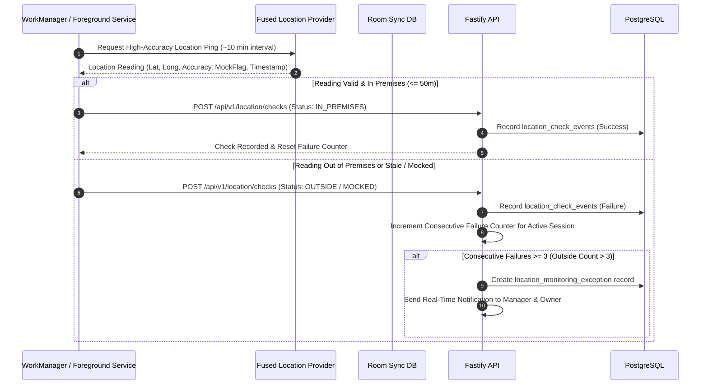

# Geofencing & Periodic GPS Monitoring Engine (`docs/LOCATION_MONITORING.md`)

## 1. Premises Geofencing Specification
- **Geofence Radius**: Configurable per premises; default **50 metres**.
- **Distance Formula**: Spherical Geodesic Haversine formula executed on Android & backend:
  $$d = 2r \arcsin\left(\sqrt{\sin^2\left(\frac{\Delta \phi}{2}\right) + \cos(\phi_1)\cos(\phi_2)\sin^2\left(\frac{\Delta \lambda}{2}\right)}\right)$$
- **Max Location Accuracy Allowed**: $30\text{ metres}$. If $Accuracy > 30\text{m}$, the location reading is marked `LOW_ACCURACY` and re-attempted.

---

## 2. Periodic GPS Checks (~10-Minute Active Shift Engine)

During active shift hours, the Android client executes periodic background location checks.

---

## 3. The 3-Consecutive-Outside-Pings Rule & Manual Resolution Policy

### Policy Specification
1. **Trigger**: When active shift monitoring records **3 consecutive outside pings** (`consecutiveFailures >= 3`, outside count $> 3$).
2. **Alert Broadcast**:
   - High-priority push / real-time notification sent to Manager and Owner dashboards.
   - Notification sent to Staff device.
3. **Manual Attendance Marking & Action Buttons**:
   - Action buttons appear on the Owner and Manager dashboard and remain visible and active **until the shift or overtime is completely finished/completed**.
   - Owner or Manager can manually mark attendance as `ABSENT`, `HALF_DAY`, `LEAVE`, or resume tracking (`RESUME`).
4. **Default Present Rule (No Action Taken)**:
   - **CRITICAL**: If the owner or manager **does not press any button** before the shift or overtime completes, the system **defaults to Present** (`PRESENT`).
5. **Counter Reset**:
   - A single valid `IN_PREMISES` check resets the consecutive failure counter to 0.
