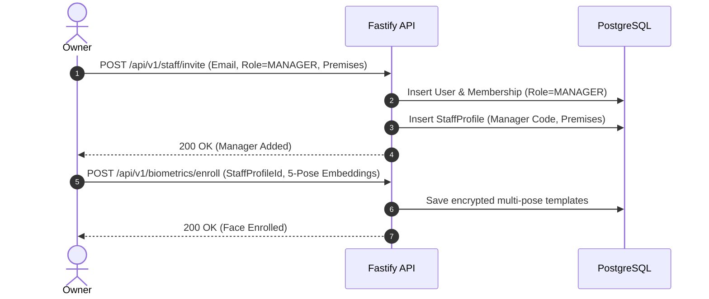
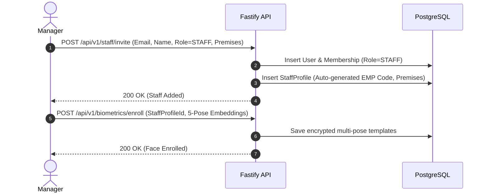

# Role Permissions & Invitation Workflows (`docs/ROLE_PERMISSIONS.md`)

## 1. Role Permission Matrix

| Module / Action | Owner | Manager | Staff |
| :--- | :---: | :---: | :---: |
| **Self-Registration** | Yes | No | No |
| **Create/Configure Organization** | Yes | No | No |
| **Configure Premises & Geofence** | Yes | No | No |
| **Add / Deactivate Managers** | Yes | No | No |
| **Add / Deactivate Staff** | View Only | Yes | No |
| **Assign & Edit Shift Templates** | View Only | Yes | No |
| **Complete Face Enrollment** | Supervise Managers | Supervise Staff | No (Manager/Owner supervised) |
| **Perform Clock-in / Clock-out** | No | If Employed | Yes |
| **Active Shift GPS Checks** | No | If Employed | Yes |
| **View Attendance Exceptions** | Yes | Yes | Own Only |
| **Resolve Manual Attendance Corrections** | Review/Approve | Yes | Request Only |
| **Submit Leave Requests** | No | Request | Request |
| **Approve Leave Requests** | Escalations | Yes | No |
| **Configure Staff Salary Structures** | View Policy | Yes | No |
| **View Wallet Balances & Ledgers** | Org Overview | Own + Staff | Own Only |
| **Prepare Monthly Payroll Draft** | View | Yes | No |
| **Approve & Lock Monthly Payroll** | Yes | Submit | No |
| **Record Manual Salary Payments** | View | Yes | No |
| **Access Itemized Payslips** | Org Summary | Own Payslip | Own Payslip |
| **View Operational Audit Logs** | Full | Partial | None |

---

## 2. Invitation Workflows

### 2.1 Owner Adds Manager Workflow

### 2.2 Manager Adds Staff Workflow

---

## 3. Organization Isolation Policies
1. Every user belongs to one or more organizations via the `memberships` table.
2. The user's active `organization_id` is encoded in the session JWT.
3. Every database query in Fastify repositories **must** explicitly include `WHERE organization_id = session.organization_id`.
4. Cross-tenant data leakage is strictly audited and tested in security regression tests.
