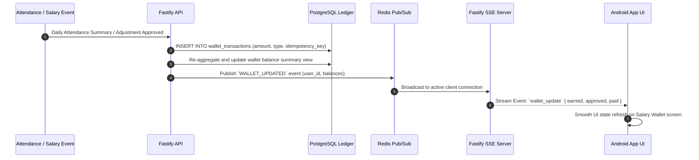

# Real-Time Wallet & Double-Entry Ledger Architecture (`docs/WALLET_LEDGER.md`)

## 1. Double-Entry Append-Only Ledger Principle

User salary wallets are **not** simple mutable balance numbers. Every wallet balance is an aggregated view calculated from an immutable, append-only ledger table `wallet_transactions`.

Direct SQL `UPDATE wallets SET balance = X` is strictly prohibited.

---

## 2. Wallet Transaction Types & Accounting Rules

| Transaction Type | Balance Affected | Direction | Trigger Event |
| :--- | :--- | :---: | :--- |
| `SALARY_ACCRUAL` | `earned_balance_cents` | `+` | Verified daily attendance completion |
| `BONUS_CREDIT` | `earned_balance_cents` | `+` | Manager recorded bonus |
| `HOLIDAY_PAY_CREDIT` | `earned_balance_cents` | `+` | Automated holiday earnings credit |
| `WEEKLY_OFF_CREDIT` | `earned_balance_cents` | `+` | Automated weekly-off earnings credit |
| `ADVANCE_DISBURSEMENT` | `earned_balance_cents` | `-` | Approved salary advance payout |
| `AUTHORIZED_DEDUCTION`| `earned_balance_cents` | `-` | Approved penalty or penalty deduction |
| `PAYROLL_SETTLEMENT` | `earned_balance` $\rightarrow$ `approved_unpaid` | Transfer | Monthly payroll approval & lock |
| `PAYMENT_CONFIRMATION` | `approved_unpaid` $\rightarrow$ `paid_balance` | Transfer | Recorded salary disbursement |
| `REVERSAL` | Affected Balance | Dual | Corrective transaction entry |

---

## 3. Real-Time Synchronization Pipeline

---

## 4. Financial Safeguards
1. **Idempotency Keys**: Every transaction request includes a unique UUID idempotency key to prevent double posting.
2. **PostgreSQL Serializable Transactions**: Ledger insertions execute inside strict SQL transactions.
3. **Reversals**: Errors are fixed exclusively by writing explicit `REVERSAL` transactions referencing the original transaction ID.
